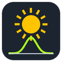

# ioBroker.pvnode

**PV production forecast from [pvnode.com](https://pvnode.com) (API v2) for ioBroker.**

🇩🇪 [Deutsche Anleitung](docs/de/README.md)

## Features

- pvnode **API v2** with saved sites (Site ID) – the v1 API is switched off by pvnode on 31.12.2026
- **All plans** (Free, Light, Plus): features are detected automatically from the API response, no plan setting needed
- **Quota-friendly polling**: the adapter only asks for data when pvnode has computed a new forecast (`next_poll_at`), keeps the last forecast over restarts and shows the remaining monthly requests
- Values **per string** (module area), e.g. east/west roofs
- Locally computed every 5 minutes, without API requests: current power, energy of the next hour, **remaining energy today**, expected energy so far, peak power and time
- Daily forecast for up to 7 days (depending on plan)
- Optional: weather, irradiance, clear-sky power and – on paid plans – the **variability band** (min/max)
- JSON series for charts in VIS

## Setup

1. Create a site with your strings at [pvnode.com](https://pvnode.com/sites/new) and copy your API key.
2. Install the adapter and enter the API key.
3. Select the site (with only one site you can leave it empty).

## States

| State | Description |
| --- | --- |
| `now.power` | Forecast power of the current 15-minute slot (W) |
| `now.energy_next_hour` | Expected energy in the next hour (kWh) |
| `today.energy` / `tomorrow.energy` | Daily forecast (kWh) |
| `today.remaining` | Remaining energy today from now on (kWh) |
| `today.expected_so_far` | Energy expected until now (kWh) – compare with your real production |
| `today.peak_power` / `today.peak_time` | Peak of the day |
| `days.N.*` | Daily forecast, N = 0 today … 6 |
| `strings.N.*` | Per string: current power, today / tomorrow / remaining energy, orientation, tilt, kWp |
| `weather.*` | Weather and irradiance of the current slot (optional) |
| `*_min` / `*_max` | Variability band (paid plans only) |
| `json.today` / `json.forecast` | Series `[{t, pv, s0, s1, …}]`, t = epoch ms, power in W |
| `json.daily` | Daily values as returned by pvnode |
| `info.requestsRemaining` | Remaining requests this month |
| `info.nextPoll` | Time of the next API request |
| `control.refresh` | Request a new forecast now (costs one request) |

## Plans and requests

| Plan | Forecast | New forecast | Requests / month |
| --- | --- | --- | --- |
| Free | today + tomorrow | 1× per day | 250 |
| Light | 7 days | 24× per day | 3,000 |
| Plus | 7 days, variability band | up to 144× per day | 3,000 |

The adapter follows `next_poll_at`, so on the Free plan it needs about one request per day.

## Why this adapter?

We had trouble getting pvnode forecasts into ioBroker reliably with existing solutions – in our setup we only got empty values. So we decided to build a simple, uncomplicated adapter that does exactly one thing: bring the pvnode forecast into ioBroker, with as few settings and requests as possible.

## Disclaimer and thanks

This adapter is an independent community project. We are **not affiliated with pvnode** in any way, and pvnode does not provide support for this adapter. pvnode is a trademark of its owner.

Many thanks to the pvnode team for providing their service and the public API that makes this adapter possible.

## Changelog

<!--
    Placeholder for the next version (at the beginning of the line):
    ### **WORK IN PROGRESS**
-->

### 0.1.3 (2026-11-12)

- Much lower memory and CPU usage (date formatters are cached)

### 0.1.2 (2026-11-12)

- Coffee cup button in the settings

### 0.1.1 (2026-11-12)

- Smaller donation link in the settings
- Buy me a coffee link added

### 0.1.0 (2026-11-12)

- Initial release

## License

MIT License

Copyright (c) 2026 AlPi-BRV

See [LICENSE](LICENSE).
